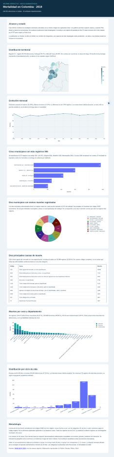

# Mortalidad en Colombia 2019 — Dashboard interactivo

**Autor:** Daniel Ramos  
**Aplicación web:** https://mortalidad-colombia-2019-4s76.onrender.com  
**Repositorio:** https://github.com/danielramos1998dr-oss/mortalidad-colombia-2019

## 1. Introducción

Este proyecto presenta una aplicación web interactiva para explorar las defunciones no fetales registradas en Colombia durante 2019. Se desarrolló en Python mediante Dash, Plotly y Pandas, utilizando los archivos de mortalidad, códigos de causas y DIVIPOLA suministrados para la actividad, con referencia a las estadísticas vitales del DANE.

El dashboard reúne siete visualizaciones y filtros por departamento, sexo y periodo. Su propósito es facilitar la identificación de patrones descriptivos territoriales, temporales y demográficos, sin confundir los recuentos absolutos con tasas de mortalidad.

## 2. Objetivo

Analizar y presentar de forma interactiva la distribución de las defunciones no fetales de Colombia en 2019 según departamento, municipio, mes, causa de muerte, sexo y grupo de edad, y publicar la aplicación en un servicio web accesible mediante una URL pública.

## 3. Aplicación publicada

- **Dashboard en Render:** https://mortalidad-colombia-2019-4s76.onrender.com
- **Código fuente en GitHub:** https://github.com/danielramos1998dr-oss/mortalidad-colombia-2019
- **Rama de publicación:** `main`.
- **Alojamiento:** Render (Web Service, plan gratuito).

El servicio se desplegó mediante Render y se confirmó su estado **Live** el 1 de noviembre de 2026. En el plan gratuito, la primera visita después de un periodo de inactividad puede tardar más mientras se reactiva el servidor.

## 4. Software y tecnologías

- Python 3.11.11
- Dash 3.2.0 (interfaz web y controles interactivos)
- Plotly 6.3.0 (visualizaciones)
- Pandas 2.2.3 (preparación y análisis de datos)
- OpenPyXL 3.1.5 (lectura de Excel)
- Gunicorn 23.0.0 (servidor de producción en Render)
- Visual Studio Code, GitHub y Render

## 5. Estructura del proyecto

```text
mortalidad-colombia-2019/
├── app.py                 # Aplicación Dash y callbacks
├── analysis.py            # Limpieza, filtros y agregaciones
├── prepare_data.py        # Preparación de datos a partir de Excel
├── requirements.txt       # Dependencias del proyecto
├── render.yaml            # Configuración de despliegue
├── .python-version        # Versión de Python
├── .gitignore             # Exclusiones de Git
├── README.md              # Documentación
├── assets/                # Estilos CSS y recursos del mapa
├── data/                  # Datos procesados, catálogo y Excel originales
├── docs/                  # Informe complementario y evidencias
└── tests/                 # Pruebas automatizadas
```

La carpeta `.venv` no se incluye en el repositorio porque el entorno virtual se crea de forma local.

## 6. Instalación y ejecución local

Clonar el repositorio:

```bash
git clone https://github.com/danielramos1998dr-oss/mortalidad-colombia-2019.git
cd mortalidad-colombia-2019
```

En Windows, con Python 3.11 instalado, ejecutar desde PowerShell:

```powershell
py -3.11 -m venv .venv
.\.venv\Scripts\python.exe -m pip install -r requirements.txt
.\.venv\Scripts\python.exe app.py
```

Abrir en el navegador: http://127.0.0.1:8050

En Linux o macOS:

```bash
python3.11 -m venv .venv
source .venv/bin/activate
pip install -r requirements.txt
python app.py
```

Los datos procesados se incluyen en `data/`. Si se requiere reconstruirlos a partir de los Excel originales, ejecutar `python prepare_data.py` antes de iniciar la aplicación.

## 7. Despliegue en Render

1. Crear un repositorio público de GitHub con el código, los datos necesarios y `requirements.txt`.
2. En Render, seleccionar **New > Web Service**, conectar GitHub y elegir el repositorio `mortalidad-colombia-2019`.
3. Configurar **Language: Python 3**, **Branch: main** y dejar **Root Directory** vacío.
4. Usar el comando de compilación:

   ```bash
   pip install -r requirements.txt
   ```

5. Configurar el comando de inicio:

   ```bash
   gunicorn app:server --bind 0.0.0.0:$PORT --workers 1 --threads 4 --timeout 120
   ```

6. Utilizar Python 3.11.11 (`.python-version` o variable `PYTHON_VERSION=3.11.11`), seleccionar la instancia **Free** y desplegar.
7. Verificar el estado **Live**, abrir la URL pública y comprobar los filtros y visualizaciones.

El archivo `render.yaml` también documenta estos parámetros para un despliegue mediante Blueprint.

## 8. Visualizaciones e interpretación de resultados

Los siguientes valores corresponden a la vista nacional del conjunto analizado: **244.355 defunciones no fetales** durante 2019. Los resultados cambian al aplicar filtros.

### 8.1. Distribución territorial por departamento

El mapa representa el número de defunciones registrado por departamento mediante marcadores sobre las capitales. Los mayores recuentos corresponden a **Bogotá D. C. (38.760)**, **Antioquia (34.473)** y **Valle del Cauca (28.443)**. El tamaño del marcador representa cantidad absoluta, no tasa poblacional ni riesgo de morir.

### 8.2. Evolución mensual

El gráfico de líneas muestra las defunciones por mes. **Diciembre (21.678)** presenta el recuento más alto y **febrero (17.974)** el más bajo, con una diferencia de **3.704 registros**. Este contraste no demuestra por sí solo estacionalidad y debe interpretarse teniendo en cuenta la diferente duración de los meses.

### 8.3. Cinco ciudades con más defunciones asociadas al código X95

El gráfico de barras considera las causas cuyo código comienza por **X95** (agresión con disparo de otras armas de fuego y las no especificadas). Los mayores recuentos son **Cali (971)**, **Bogotá (601)**, **Medellín (428)**, **Barranquilla (260)** y **Cúcuta (206)**. El total nacional analizado para X95 es **9.273**. No corresponde a todos los homicidios ni a un índice de violencia.

### 8.4. Diez territorios con menor número de defunciones

El gráfico circular presenta los diez municipios o áreas con el menor **número positivo de registros**. En el conjunto seleccionado, cada territorio presenta un registro y representa el **10 % del subtotal** del gráfico. Como no se dispone de denominadores poblacionales, este resultado **no debe interpretarse como una tasa o índice de mortalidad**.

### 8.5. Diez principales causas de muerte

La tabla clasifica los códigos de causa de muerte de mayor a menor frecuencia, mostrando código, descripción y total. El código **I219** registra **35.088 defunciones (14,36 % del total)** y ocupa el primer lugar. La tabla permite consultar las otras nueve causas directamente en el dashboard.

### 8.6. Mortalidad por sexo y departamento

Las barras apiladas permiten comparar la composición de las defunciones en cada departamento. A escala nacional se registran **134.573 hombres (55,07 %)**, **109.689 mujeres (44,89 %)** y **93 casos de sexo indeterminado (0,04 %)**. Son distribuciones de fallecimientos, no tasas específicas por sexo.

### 8.7. Distribución por grupos de edad

El gráfico organiza la variable `GRUPO_EDAD1` en las categorías solicitadas para el ciclo de vida. El grupo de **60 a 84 años** concentra **115.453 registros (47,25 %)** y se identifican **23 registros** con edad desconocida. Los intervalos de edad tienen diferentes amplitudes, por lo que la altura de las barras no representa riesgo individual.

**Agrupación empleada:** neonatal (0–4), infantil (5–6), primera infancia (7–8), niñez (9–10), adolescencia (11), juventud (12–13), adultez temprana (14–16), adultez intermedia (17–19), vejez (20–24), longevidad (25–28) y edad desconocida (29). Son agrupaciones operativas de la actividad y no sustituyen las definiciones epidemiológicas estrictas.

## 9. Metodología y consideraciones

- Se analizan **defunciones no fetales registradas en 2019**. Cada fila se contabiliza como un registro de defunción.
- Los códigos de causa se enlazan a sus descripciones y los códigos DIVIPOLA permiten organizar los resultados territoriales.
- Los gráficos presentan **conteos absolutos**, ya que no se incorporaron poblaciones de referencia para calcular tasas por municipio, departamento, edad o sexo.
- La ubicación representa el territorio de ocurrencia registrado en la fuente, no necesariamente el lugar de residencia ni el lugar específico de un hecho violento.
- La categoría X95 es una selección específica de causas externas y no equivale a todos los homicidios.
- Se conserva la categoría de sexo indeterminado y la de edad desconocida cuando están presentes.

## 10. Evidencias gráficas

El repositorio contiene un **informe HTML complementario** con sus propias visualizaciones y la siguiente captura ilustrativa:



Para documentar específicamente el funcionamiento de la **aplicación Dash desplegada**, agregar capturas reales de la URL pública en la carpeta `docs/capturas/` e insertarlas aquí. Se recomienda mostrar la vista general, el mapa, los gráficos mensuales, los rankings, la tabla de causas, la comparación por sexo, los grupos de edad y una selección filtrada por departamento.

La imagen del informe complementario no sustituye las capturas de la aplicación en Render.

## 11. Fuentes

- [DANE — Estadísticas Vitales, microdatos 2019](https://microdatos.dane.gov.co/index.php/catalog/696).
- Archivos fuente: defunciones no fetales de 2019, catálogo de códigos de causas y DIVIPOLA suministrados para la actividad.
- [Documentación de Dash](https://dash.plotly.com/).
- [Documentación de Plotly para Python](https://plotly.com/python/).
- [Documentación de despliegue de aplicaciones Flask/WSGI en Render](https://render.com/docs/deploy-flask).

---

**Desarrollado por Daniel Ramos — 2026.**
